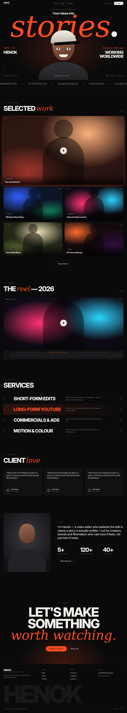

# Global · HEADER, MOBILE MENU, FOOTER

Files: `components/layout/{Header,MobileMenu,Footer,SiteLayout}.tsx`. Visible in every public mockup (`[1]` header, last number = footer, e.g. home `[15]`).

## Header (desktop ≥ 701px)
- Height **76px** (`--header-h`), `position:fixed; top:0; inset-x:0; z-index:30`. Container `container-x`, **3-column grid** `1fr auto 1fr`, items centered.
- **Left — logo:** two lines: `HENOK` Inter Tight 800 20px `-0.03em`; below it mono 9px `.18em` uppercase `muted`: `VIDEO EDITOR`. Links to `/`.
- **Center — nav pill:** inline-flex, gap 6px, padding 5px, 1px `line` border, radius 999, bg `rgba(17,17,19,.6)` + blur 14px. Links **Work · About · Contact**: 13px 500, px 18 py 8, `muted`; **active** = bg `text`, colour dark (sliding highlight with `layoutId="nav-pill"`).
- **Right:** mono clock `ADDIS 21:31` (`muted`, updates every 30s, `useLocalTime(timeZone)` from config) + solid `sm` button **Let's talk** with a small green dot → `/contact`.
- Behaviour: A15 (hide on scroll down / show on scroll up; blur + `bg/70` after 40px).

## Header (mobile ≤ 700px)
Height 64px. Left: logo. Right: 44px circular outlined **menu button** (two 16px × 1.5px lines, 5px gap), `aria-label="Open menu"`, `aria-expanded`. Hide nav pill, clock and the button.

## Mobile menu overlay
Full-screen, bg `bg`, z-index 50. Top bar identical (logo + ✕ button). Links stacked, left-aligned at 20px padding, display style **56px** uppercase (Home, Work, About, Contact) with mono index `01…` beside each; bottom: email, socials row, availability dot. Animation A16. Closes on link click, ESC, route change. Lock body scroll.

## Footer
Top border 1px `line`, padding `56px 0 36px`.
- Grid `1.4fr 1fr 1fr 1fr` gap 40px (**mobile: 2 columns; first column spans both**):
  1. Logo (`HENOK` 26px) + mono caption + tagline paragraph (15px muted, max 320px)
  2. **Pages** — Work, About, Contact
  3. **Social** — YouTube ↗, Instagram ↗, LinkedIn ↗ (from config)
  4. **Status** — green dot **Available for projects** / muted *Reply within 24h*
  Column headings: mono 11px `.14em` muted, mb 16px; list items 15px, mb 10px; hover accent.
- **Giant wordmark** `HENOK`: display, `clamp(80px, 19vw, 290px)`, `-0.06em`, line-height .8, colour `surface-2`, mt 40px, `overflow:hidden; white-space:nowrap`, `aria-hidden`.
- Base row (mt 28px, pt 20px, border-top `line`): mono `© 2026 Henok. All rights reserved.` left · `Back to top ↑` right (smooth scroll). Mobile: stacked.
