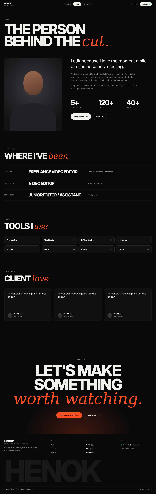

# Page spec · ABOUT  `/about`

Files: `src/pages/About.tsx`, `components/about/{Experience,Toolkit,Stats}.tsx`, reuse `Testimonials`, `CTASection`.

## Mockups
| View | Image |
|---|---|
| Desktop | `design/mockups/desktop/about.png` |
| Annotated | `design/mockups/desktop-annotated/about.png` |
| Mobile | `design/mockups/mobile/about.png` |
| Source | `design/mockups/html/about.html` |

---

## [1] Header (global)

## [2] Title block
`ptitle` (170px top). Mono `[ About ]`. `h1` **THE PERSON / BEHIND THE *cut.*** — `clamp(48px, 9vw, 140px)`, line-height .85, "cut." serif accent.

## [3] Bio section
`py-section` with top padding 60px. 2-column grid `5fr 7fr`, gap 80px, `align-items:start` (mobile: 1 column, gap 40px, portrait first).

## [4] Portrait (left)
Card aspect **4/5**, radius 16, bg radial `#3a3a40 → #121214`, `portrait.png` bottom-aligned (or placeholder). **Sticky on desktop:** `position:sticky; top:100px`. Not sticky on mobile.

## [5] Bio text (right)
1. Lead — `clamp(26px, 2.8vw, 40px)`, weight 500, letter-spacing -.02em.
2. Body paragraphs — 18px, `muted`, max-width 640px, mt 28px / 20px.
3. **[6] Stats** — 3 columns (same component as Home), mt 48px, counters A8.
4. Buttons row (mt 40px, gap 12px): solid `lg` **Download CV ↓** (hide if `cvUrl` empty) + ghost `lg` **Let's talk** (→ `/contact`).

## [7] Experience
No top padding. Label `[ Experience ]`, h2 **WHERE I'VE *been***. Rows reuse the Services row style but columns `200px 1fr 1fr 40px`: mono date range · role `clamp(24px, 2.6vw, 38px)` uppercase · place (muted) · empty. Hover A9. Mobile: stack date above role; hide 4th col.

## [8] Toolkit
Label `[ Toolkit ]`, h2 **TOOLS I *use***. Grid **4 columns** (mobile 2), gap 14px. Each tool = card (`surface`, border `line`, radius 16, padding 22) with tool name (Inter Tight 700) left and mono index `01`… right. Hover: border `accent`.

## [9] Testimonials
Same as Home [12] (hide if none).

## [10] CTA · [11] Footer — shared components.

## Acceptance checklist
- [ ] Matches `about.png` at 1440 and mobile
- [ ] Portrait sticky on desktop only
- [ ] Counters animate once; Download CV hidden when no URL
