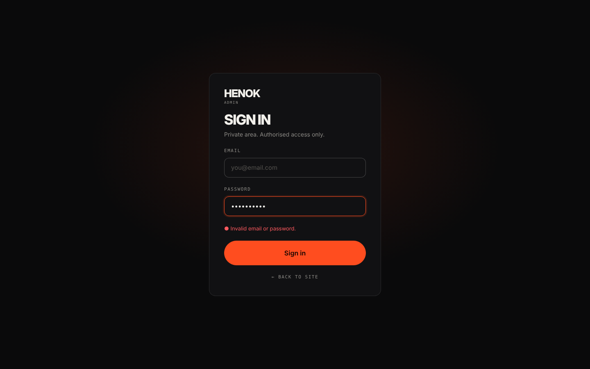

# Page spec · ADMIN LOGIN  `/admin/login`

Files: `pages/admin/Login.tsx`, `hooks/useAuth.ts`. Lazy-loaded. `noindex`. No site header/footer.

## Mockups
| View | Image |
|---|---|
| Desktop | `design/mockups/desktop/admin-login.png` |
| Annotated | `design/mockups/desktop-annotated/admin-login.png` |
| Mobile | `design/mockups/mobile/admin-login.png` |

## Layout
Full-height centered (`min-height:100svh`), bg `bg` + faint accent glow (`rgba(255,77,31,.12)`).

## [1] Card
Width **420px** (mobile `calc(100% - 40px)`, padding 26px), padding 36px, bg `surface`, 1px `line`, radius 16, `display:grid; gap:20px`.
1. Logo `HENOK` 26px + mono `ADMIN`
2. Heading display 34px **SIGN IN** + muted 14px *Private area. Authorised access only.*
3. **[2] Email** field (admin boxed input) · **[3] Password** field (type password, show/hide eye toggle `aria-label`)
4. **[4] Error line** (danger, 13px, with ● glyph): shown only on failure — *Invalid email or password.* (never reveal which one was wrong). Network error: *Can't reach the server. Try again.*
5. **[5]** Accent `lg` full-width button **Sign in** (loading: `Signing in…`, disabled).
6. Mono link `← Back to site`.

## Behaviour
- `supabase.auth.signInWithPassword`. On success → `/admin`. If already logged in → redirect `/admin`.
- Enter key submits. Autofocus email. `autocomplete="email"` / `current-password`.
- No sign-up, no "forgot password" UI in v1.
- If Supabase not configured: show banner *Supabase isn't configured — add keys to .env.local* and disable the button.
