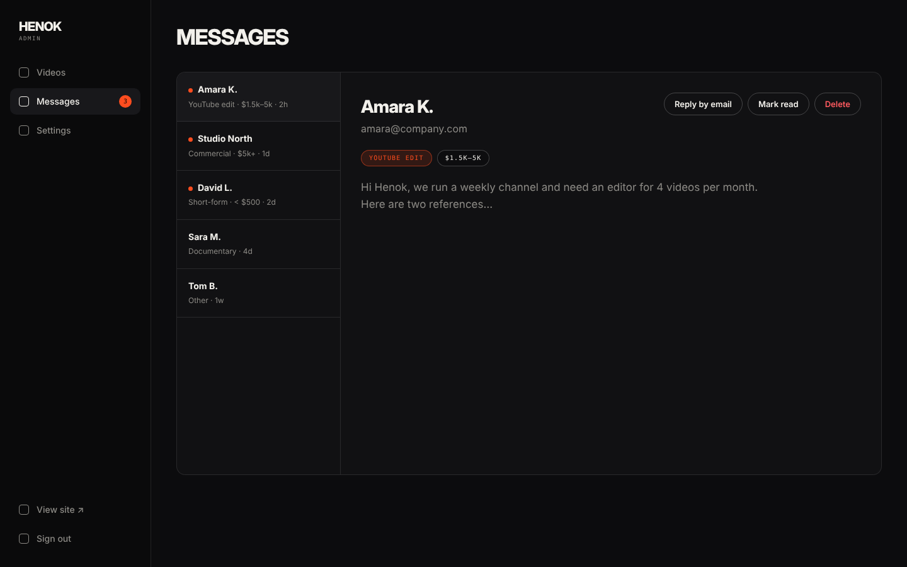

# Page spec · ADMIN · MESSAGES  `/admin/messages`

File: `pages/admin/Messages.tsx`, `components/admin/MessageList.tsx`.

## Mockups
| View | Image |
|---|---|
| Desktop | `design/mockups/desktop/admin-messages.png` |
| Annotated | `design/mockups/desktop-annotated/admin-messages.png` |
| Mobile | `design/mockups/mobile/admin-messages.png` |

## Layout
Same `AdminLayout`. Header `h1` **MESSAGES**.

## [2] Two-pane box
Grid `260px 1fr`, min-height 640px, 1px `line`, radius 14, overflow hidden, bg `surface`. **Mobile:** single column — list view; tapping a message opens the detail full-width with a `← Back` button.

## [3] List (left)
Each item padding `16px 18px`, border-bottom 1px `line`, 14px. Name in 600 with a 7px accent **unread dot** before it; below: muted 12px `Project type · relative time` (`2h`, `1d`, `1w`). Selected = bg `surface-2`. Newest first. Selecting a message auto-marks it read (after 1s).

## [4] Detail (right)
Padding 32px, grid gap 20px.
- Row: name (display 28px, 800) + muted email on the left; right: ghost `sm` buttons **Reply by email** (`mailto:<email>?subject=Re: your project`), **Mark read/unread**, **Delete** (danger text, confirm).
- Chips: project type (accent chip) + budget chip (if any).
- Message body: 17px `muted`, `white-space: pre-wrap`, max-width 640px. Full timestamp mono below.
- Empty detail state: *Select a message.*

## States
Loading skeleton · Empty list: *No messages yet. They'll show up here when someone uses the contact form.* · Unread count syncs to the sidebar badge and the stat card on Videos.
