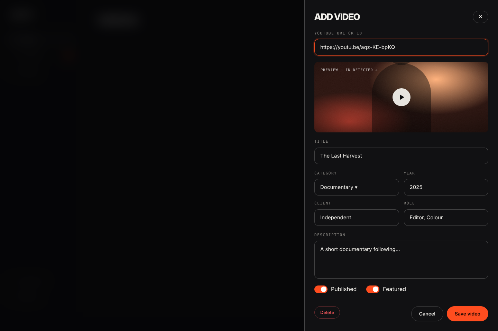

# Component spec · ADMIN · ADD / EDIT VIDEO DRAWER

File: `components/admin/VideoDrawer.tsx`.

## Mockups
| View | Image |
|---|---|
| Desktop | `design/mockups/desktop/admin-video-drawer.png` |
| Annotated | `design/mockups/desktop-annotated/admin-video-drawer.png` |
| Mobile | `design/mockups/mobile/admin-video-drawer.png` |

## Shell [2]
Right-side drawer: `position:fixed; top:0; right:0; bottom:0; width:560px` (mobile 100%), bg `surface`, border-left 1px `line-strong`, padding 28px, `display:flex; flex-direction:column; gap:18px; overflow-y:auto`. Scrim behind: `rgba(5,5,6,.7)` + blur 6px. Slide-in A19. ESC / scrim click closes (confirm if form is dirty).

Header row: display 26px **ADD VIDEO** / **EDIT VIDEO** + ghost `sm` ✕ button.

## Fields (top → bottom)
- **[3] YouTube URL or ID** — accepts `https://youtu.be/ID`, `https://www.youtube.com/watch?v=ID`, `/shorts/ID`, `/embed/ID`, or a bare 11-char ID. Parse with `parseYouTubeId` (`snippets/youtube.ts`). Show inline error *That doesn't look like a YouTube link* when invalid.
- **[4] Preview** — 16:8 thumbnail (radius 12) with play button; label `PREVIEW — ID DETECTED ✓`. Click play → mounts the iframe in place (so Henok can watch before publishing). Hide until an ID is detected.
- **[5] Title** — required, max 120. Auto-generate **slug** from title (lowercase, hyphens, unique; show slug as small mono text under title, editable on click).
- **[6] 2×2 grid** — Category (select: Documentary / YouTube / Shorts / Commercials, required) · Year (number, default current year) · Client · Role.
- Tools — tag input (type + Enter, max 8) *(below the grid)*.
- Description — textarea 110px, max 1000.
- Custom thumbnail URL — optional, small muted help text *Leave empty to use the YouTube thumbnail.*
- **[7] Toggles** — Switch **Published** (default on) and Switch **Featured** (default off). Helper: featured videos appear on Home (max 5 shown).

## [8] Footer actions
Pinned to bottom (`margin-top:auto`): left danger-outlined `sm` **Delete** (edit mode only); right ghost **Cancel** + accent **Save video**.
- Save: validate → `api.createVideo` / `api.updateVideo` (new videos get `display_order = max + 1`). Disabled + `Saving…` while pending. Success → close drawer + toast `Video saved`.
- Errors from API shown in a danger banner at the top of the drawer.

## Input style
Boxed admin inputs (see design system): 48px, radius 12, bg `surface`, border `line-strong`; mono 11px uppercase labels above. Focus = accent border + `0 0 0 3px accent-soft` (URL field is shown focused in the mockup).
