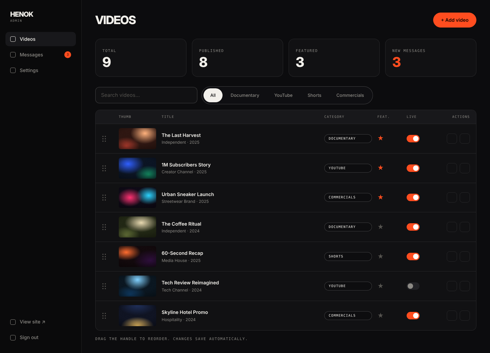

# Page spec · ADMIN · VIDEOS  `/admin`

Files: `pages/admin/Videos.tsx`, `components/layout/AdminLayout.tsx`, `components/admin/{StatCards,VideoTable,SortableRow,ProtectedRoute}.tsx`. Uses `@dnd-kit/*`.

## Mockups
| View | Image |
|---|---|
| Desktop | `design/mockups/desktop/admin-videos.png` |
| Annotated | `design/mockups/desktop-annotated/admin-videos.png` |
| Mobile | `design/mockups/mobile/admin-videos.png` |

## Admin layout (`AdminLayout`)
Grid `240px 1fr`, min-height 100svh, main bg `#0C0C0E`. **Mobile:** sidebar becomes a horizontal scrolling tab bar on top.

### [1] Sidebar
bg `bg`, border-right 1px `line`, padding `24px 16px`, gap 4px. Logo block (`HENOK` + mono `ADMIN`) padding `8px 14px 24px`. Nav items (height 42, px 14, radius 10, 14px 500, 16px outlined square icon placeholder → use lucide icons: `Film`, `Mail`, `Settings`): **Videos**, **Messages** (with accent count badge of unread), **Settings**. Active = bg `surface-2`, colour `text`; inactive `muted`. Bottom (pushed with flex-1 spacer): **View site ↗** and **Sign out**.

## Page
Main padding `32px 40px` (mobile 20px).

### Header row
`h1` **VIDEOS** (display 34px) left; **[2]** accent `md` button **+ Add video** right → opens drawer (`admin-video-drawer.md`).

### [3] Stat cards
4-col grid (mobile 2×2), gap 16px, mb 28px. Card: `surface`, 1px `line`, radius 16, padding 20. Mono label + number display 40px. Cards: **Total · Published · Featured · New messages** (the last number in accent).

### [4] Toolbar
Flex gap 12px, mb 16px: boxed search input (300px; mobile full width) `Search videos…` (filters by title/client, debounce 200ms) + the same filter pill bar as the public site (All + 4 categories).

### [5] Table
Container: 1px `line`, radius 14, overflow hidden, bg `surface`. Header row bg `surface-2`, mono 10px labels. Row grid columns: `34px 110px 1fr 140px 70px 80px 90px` (drag · thumb · title+meta · category chip · featured · live · actions), gap 16, padding `12px 18px`, border-top 1px `line`, 14px text.
- Drag handle: 14×20 dotted grip. Thumb: 110px 16:9, radius 6.
- Title 600 + small muted `Client · Year`.
- Featured = ★ button (accent when on). Live = Switch. Actions = two 30px outlined icon buttons: Edit (pencil), Delete (trash).
- **Mobile row:** grid `70px 1fr 60px` → thumb, title/meta, live switch (hide others; tapping row opens drawer).
- Footer hint mono: `Drag the handle to reorder. Changes save automatically.`

## Behaviour
- **Reorder:** dnd-kit `SortableContext` vertical list; on drop optimistically reorder, then persist `display_order` = index for affected rows (batch upsert). On error: revert + toast *Couldn't save order*.
- Toggling ★ / Live updates instantly (optimistic) → `api.updateVideo`.
- Delete → confirm dialog (`Delete "<title>"? This can't be undone.`) → delete.
- Reorder is disabled while a search/filter is active (show muted note).
- Toasts: bottom-right, `surface-2`, 1px `line-strong`, auto-dismiss 3s.
- Empty state: *No videos yet.* + accent button **Add your first video**.
- Loading: skeleton rows.

## ProtectedRoute
`snippets/ProtectedRoute.tsx`. While auth is loading show a centered mono `Loading…`.
