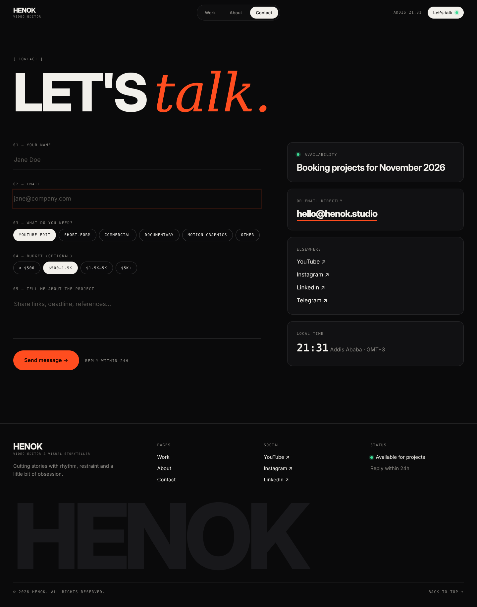

# Page spec · CONTACT  `/contact`

Files: `src/pages/Contact.tsx`, `components/contact/{ContactForm,ContactAside}.tsx`.

## Mockups
| View | Image |
|---|---|
| Desktop | `design/mockups/desktop/contact.png` |
| Annotated | `design/mockups/desktop-annotated/contact.png` |
| Mobile | `design/mockups/mobile/contact.png` |
| Source | `design/mockups/html/contact.html` |

---

## [1] Header · [2] Title
`ptitle`; mono `[ Contact ]`; `h1` **LET'S *talk.*** at `clamp(56px, 11vw, 176px)`.

## Layout
Section padding `40px 0 160px`. Grid `7fr 5fr`, gap 80px (**mobile: 1 column, gap 48px, form first**).

## [3] Form (left) — `display:grid; gap:36px`
Underline fields (design system "Inputs"):
1. `01 — Your name` · text · required · max 80
2. `02 — Email` · email · required · valid format · max 120. *(In the mockup this field is shown in focus state: bottom border accent.)*
3. `03 — What do you need?` · **single-select chips**: YouTube edit · Short-form · Commercial · Documentary · Motion graphics · Other (default none; required)
4. `04 — Budget (optional)` · single-select chips: `< $500` · `$500–1.5k` · `$1.5k–5k` · `$5k+` (click selected chip again to unselect)
5. `05 — Tell me about the project` · textarea, 132px tall, required, min 10, max 3000; placeholder `Share links, deadline, references…`

Chips: height 38px, px 16px, mono 11px; selected = `chip on` (bg `text`).

## [4] Submit
Accent `lg` button **Send message →** + mono hint `Reply within 24h` (ml 18px). Wrapper is below the textarea.
- States: idle · loading (button text `Sending…`, disabled, small spinner) · success · error.
- **Success:** replace the whole form with a card: display-style **MESSAGE SENT.** and *Thanks — I'll reply within 24 hours.* + ghost button "Send another".
- **Error:** inline danger text under button: *Something went wrong. Please email me directly at <email>.*
- Field errors: danger text 13px under the field, `aria-describedby`, input border `danger`.

## Anti-spam & safety
- Hidden honeypot input `website` (visually hidden, `tabIndex=-1`, `autocomplete="off"`). If filled → pretend success, send nothing.
- Min time-on-page 3s before submit allowed (else pretend success).
- Insert via `api.sendMessage()` → Supabase `messages` (RLS insert-only; DB check constraints enforce lengths). In fallback mode (no Supabase) `console.warn` and show success.
- Prevent double submit. Trim inputs. Never render user input as HTML.

## [5] Aside (right) — 4 stacked cards, gap 20px
All cards: `surface` bg, 1px `line`, radius 16, padding 28.
1. **Availability** — green pulsing dot + mono `Availability`; text display-ish 28px/1.1 600: `Booking projects for <Month YYYY>` (from settings; if `available=false` show `Fully booked — join the waitlist` with a muted dot).
2. **Or email directly** — email in Inter Tight 800 28px with 2px accent underline (`mailto:`).
3. **Elsewhere** — YouTube ↗ / Instagram ↗ / LinkedIn ↗ / Telegram ↗ (17px, hover accent), only those in config.
4. **Local time** — mono 32px `HH:MM` live clock (updates each 30s) + `<City> · GMT+3` muted.

## [6] Footer (global). No CTA section on this page.

## Acceptance checklist
- [ ] Matches mockup at 1440 & 390
- [ ] Validation + all 4 states work; honeypot present
- [ ] Row appears in Supabase `messages` (Phase 10)
- [ ] Keyboard: chips are a radio group (`role="radiogroup"`, arrow keys)
