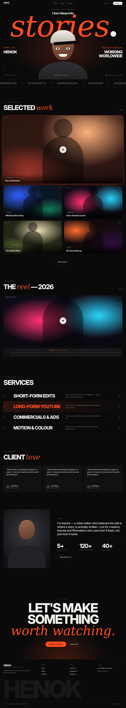

# Page spec · HOME  `/`

Files: `src/pages/Home.tsx` + `src/components/home/*`. Copy: `docs/10-content-and-copy.md`. Motion: `docs/06-animation-spec.md`.

## Mockups (open ALL of these first)
| View | Image |
|---|---|
| Desktop 1440 | `design/mockups/desktop/home.png` |
| **Annotated** (numbers = `[n]` below) | `design/mockups/desktop-annotated/home.png` |
| Mobile 390 | `design/mockups/mobile/home.png` |
| Source | `design/mockups/html/home.html` + `mock.css` |

**Section order (top→bottom):** Header → Hero → Marquee → Selected work → Showreel → Services → Testimonials → About teaser → CTA → Footer.
Page `<title>`/description: see Meta table in `docs/10`.

---

## [1] Header — see `pages/_global-header-footer.md`
Absolute/fixed over the hero, transparent at top.

## [2] Hero (`Hero.tsx`)
- `section`, height **900px desktop** (`min-h-[100svh]` max 900 on tall screens; **900px mobile**), `overflow:hidden`, `position:relative`.
- Background: `bg` + radial glow `radial-gradient(60% 55% at 50% 62%, rgba(255,77,31,.20), transparent 70%)` (this glow also moves — A3).
- Children are absolutely positioned; z-index order: giant word **1** < portrait **3** < text blocks **4** < footer row **5**.

## [3] Intro line
- Centered, `top:104px` (84px mobile). Two lines stacked:
  1. mono label `[ Video editor & visual storyteller ]` (mb 14px)
  2. **"I turn ideas into"** — Inter Tight 700, `-0.03em`, sentence case, `clamp(22px, 2.6vw, 38px)` (24px mobile), colour `text`.

## [4] Giant word "stories."
- Centered, `top:150px` (same on mobile), `font-size: clamp(120px, 24vw, 360px)` (**29vw mobile**), `line-height:.8`.
- The word **stories** = `Instrument Serif` italic, accent colour, size .98em; the **period `.` is in `text` colour** (off-white).
- Sits BEHIND the portrait (the portrait's cap overlaps only the bottom of the middle letters — intentional).
- Parallax A4. Load animation A2.

## [5] Portrait (`HeroPortrait.tsx`)
- Centered horizontally, `bottom:-60px` (-30px mobile), **width 560px × height 640px** (420×520 mobile). Bleeds off the bottom of the hero.
- **Primary implementation (do this first):** `` transparent PNG, `object-fit: contain`, `object-position: bottom`. If the file is missing render `<PortraitPlaceholder />` (inline SVG: head + cap + shoulders like the mockup).
- **Cursor behaviour:** `snippets/usePortraitLook.ts` → A3. The glow (`[2]` background) shifts opposite to the cursor.
- **Optional layered version** (when Henok provides `portrait-body.png`, `portrait-head.png`, optional `portrait-eyes.png`): stack the 3 layers in that order, apply head/eye transforms per A3. Same wrapper size.
- Annotated image shows a pill "Cursor-following portrait" — that's only a note, don't render it.

## [6] Side blocks (left & right of the portrait)
- Left: `left: var(--pad)`, `top:520px` (680px mobile). Serif italic accent line **"Hello, I'm"** 26px (17px mobile), then **HENOK** — display 46px (24px mobile), `-0.04em`, uppercase.
- Right: mirror (`right: var(--pad)`, text-right). Serif italic accent **"Based in Ethiopia"** (from config) then **WORKING / WORLDWIDE** (two lines).
- Vertical socials (desktop only ≥ 701px): `left: var(--pad)`, `bottom:36px`, three 32px circular outlined icon buttons stacked with 14px gap (YouTube, Instagram, LinkedIn) — `lucide-react`.

## [7] Hero footer row
- `bottom:36px`, inside `container-x`, `flex justify-between items-end`. Three mono labels:
  left `↓ Scroll to explore` · center `00:00:12:04 ● REC` (text colour, accent dot, A7) · right green pulsing dot + `Available — <Month YYYY>`.
- **Mobile:** stack vertically, left-aligned, gap 12px.

## [8] Marquee (`Marquee.tsx`)
- Full-width band, borders top & bottom 1px `line`, padding 22px 0. Items: Inter Tight 700, 28px (20px mobile), uppercase, colour `faint`, separated by a `✦` in accent (16px) with 56px margins. Two copies for seamless loop (A6).

## [9] Selected work (`SelectedWork.tsx`)
- `py-section` (bottom 120px). `SectionLabel [ 01 — Selected work ]` + `h2` "SELECTED *work*" left; count `(05)` mono right (bottom aligned). **Mobile:** stacked, count below title.
- Data: videos with `featured = true`, ordered by `display_order`, **max 5**.
- Layout: **card 1 full-width** (mb 24px), then **2-column grid** with 24px gap for cards 2–5. Mobile: all one column, gap 20px.
- Card = `VideoCard` (design system). In the mockup card 1 is shown in its **hover state** (accent ring, play button) — default state has no play button.
- Click card → `navigate('/work?v=<slug>')` (modal opens on the Work page).
- Below: centered ghost `lg` button **View all work →** (mt 64px) → `/work`.

## [10] Showreel (`Showreel.tsx`, `Timeline.tsx`)
- `py-section` with top padding 60px. Label `[ 02 — Showreel ]`, title **THE *reel* — 2026**, duration `01:48` mono right.
- Thumbnail frame: **aspect 21/9** (16/10 mobile), radius **20px**, grain, centered play button, top-left mono `SHOWREEL_2026.MP4`, top-right mono duration. Source = `settings.showreel_youtube_id`. Click → open the same modal player component with this video (no category/meta).
- **Timeline** below (mt 18px): bordered box (radius 14, bg `surface`, padding 14/16), three rows `V2`, `V1`, `A1`: each row = 36px mono label + 18px-tall track (`surface-2`, radius 5). Clips are `surface-3` rounded blocks at fixed % positions (V2: 6→28%, **34→52% accent-tinted**, 58→88%; V1: 0→34%, 35→60%, 61→100%; A1: one clip 0→100% at 60% opacity). **Orange playhead** 2px wide, spans all rows, animates A7.

## [11] Services (`Services.tsx`)
- Label `[ 03 — What I do ]`, h2 **SERVICES**. 4 rows. Each row grid `90px 1fr 1fr 60px` (mobile `36px 1fr 40px`, description hidden), gap 24px, padding 34px 0, border-top 1px `line` (last row also border-bottom).
  - col1 mono number `01`–`04` · col2 `h3-list` uppercase title · col3 description 16px `muted` max 420px · col4 48px circle with `↗` (outlined).
- Hover = A9. The mockup shows row 2 hovered.

## [12] Testimonials (`Testimonials.tsx`) — hide section if none
- Label `[ 04 — Kind words ]`, h2 **CLIENT *love***. 3 cards in a grid (gap 24; mobile 1 col). Card: bg `surface`, border `line`, radius 16, padding 32, min-height 300, quote 20px/1.45, footer = 40px avatar circle + name (14px 600) + role (12px muted).

## [13] About teaser (`AboutTeaser.tsx`)
- 2-column grid `5fr 7fr`, gap 80px, `align-items:center` (mobile 1 col, gap 40).
- Left: portrait card `aspect-ratio 4/5`, radius 16, bg radial `#3a3a40 → #121214`, uses `portrait.png` (or placeholder).
- Right: mono `[ About ]`, lead paragraph (`lead` style, weight 500), `Stats` (3 columns, mt 48px, pt 32px, border-top `line`; number display 64px (40px mobile) + mono caption; counters A8), then ghost `lg` button **More about me →** (mt 40px) → `/about`.

## [14] CTA (`CTASection.tsx`) — shared with other pages
- Centered, padding `180px 0 140px`, radial accent glow from the bottom (`radial-gradient(50% 60% at 50% 100%, rgba(255,77,31,.22), transparent 70%)`, A17).
- Mono `[ 05 — Contact ]`, then display `clamp(56px, 10vw, 160px)`: **LET'S MAKE / SOMETHING / *worth watching.*** (last line serif accent).
- Buttons row (mt 56px, centered, wrap): accent `lg` **hello@henok.studio ↗** (`mailto:`) + ghost `lg` **Book a call** (external link; hide if not configured).

## [15] Footer — see `pages/_global-header-footer.md`

---

## States
- Loading: cards show shimmer skeletons (`surface-2` → `surface-3` pulse, same aspect ratios). Error: *Couldn't load the work. Please refresh.* Empty featured: hide section [9].

## Acceptance checklist
- [ ] Section order and proportions match `home.png` at 1440
- [ ] Hero fits in the first viewport; giant word never clipped at 320–1920px
- [ ] Mobile matches `mobile/home.png` (hero stack, single-column cards, services w/o descriptions)
- [ ] Only one accent colour; serif accent words in every h2 as in mockup
- [ ] No iframe present before click
- [ ] Reveal animations + portrait follow work; disabled for reduced motion
