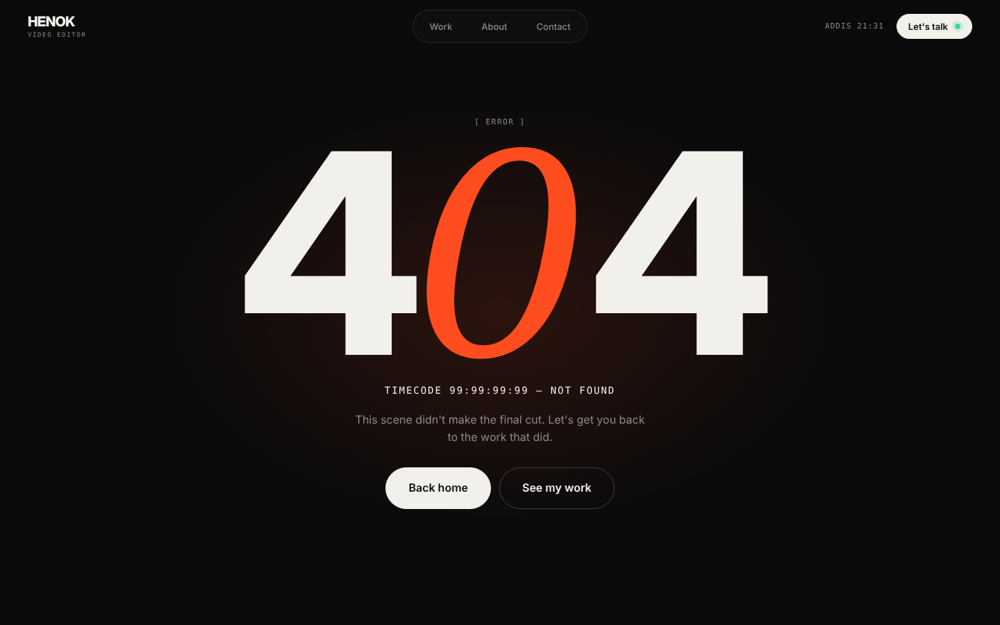

# Page spec · 404  `*`

File: `src/pages/NotFound.tsx`.

## Mockups
| View | Image |
|---|---|
| Desktop | `design/mockups/desktop/not-found.png` |
| Annotated | `design/mockups/desktop-annotated/not-found.png` |
| Mobile | `design/mockups/mobile/not-found.png` |

## Layout
- Full-height (`min-height:100svh`) flex column, centered, gap 18px, text-align center. Background: radial accent glow centered (`radial-gradient(50% 50% at 50% 50%, rgba(255,77,31,.14), transparent 70%)`).
- **[1] Header** global. No footer on this page.
- mono `[ Error ]`.
- **[2] "404"** — display, `clamp(140px, 28vw, 420px)`, line-height .8. The middle **0** is serif italic accent.
- mono 14px `text` colour: `TIMECODE 99:99:99:99 — NOT FOUND`.
- Paragraph `muted`, max-width 420px: *This scene didn't make the final cut. Let's get you back to the work that did.*
- **[3]** Buttons (mt 12px): solid `lg` **Back home** (`/`) + ghost `lg` **See my work** (`/work`).
- `document.title = "404 — Henok"`; add `<meta name="robots" content="noindex">` via `usePageMeta`.
