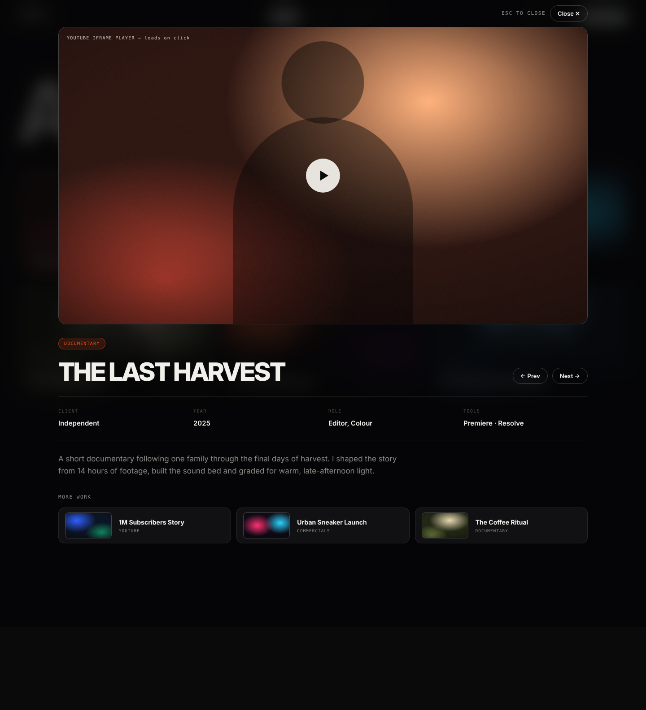

# Component spec · PROJECT MODAL  (`/work?v=<slug>`)

Files: `components/video/VideoModal.tsx`, `YouTubePlayer.tsx`. Starter code: `snippets/VideoModal.tsx`, `snippets/youtube.ts`.

## Mockups
| View | Image |
|---|---|
| Desktop | `design/mockups/desktop/project-modal.png` |
| Annotated | `design/mockups/desktop-annotated/project-modal.png` |
| Mobile | `design/mockups/mobile/project-modal.png` |
| Source | `design/mockups/html/project-modal.html` |

---

## [1] Scrim
`position:fixed; inset:0; background: rgba(5,5,6,.82); backdrop-filter: blur(18px); z-index:60`. Click closes. The page behind is the Work page (grid), still mounted.

## [2] Panel
`position:fixed; left:50%; top:60px; transform:translateX(-50%); width:min(1180px, calc(100% - 80px)); z-index:70; max-height: calc(100vh - 80px); overflow-y:auto` (hidden scrollbar). **Mobile:** width `calc(100% - 24px)`, top 70px.

## [3] Close bar
Above the panel (top:-48px, right-aligned): mono `ESC to close` (hide on touch) + ghost `sm` button **Close ✕** (`aria-label="Close video"`).

## [4] Player (`YouTubePlayer`)
- Radius **18px**, 1px `line-strong` border, **aspect 16/9**, grain on the thumbnail.
- **Initial state:** thumbnail (`maxresdefault`) + centered 76px play button. **Do not mount an iframe yet.**
- **On click** (or if opened via "autoplay" from list click — default: show thumbnail, require click): mount `<iframe src="https://www.youtube-nocookie.com/embed/<id>?autoplay=1&rel=0&modestbranding=1&playsinline=1" allow="autoplay; encrypted-media; picture-in-picture; fullscreen" allowFullScreen title="<video title>">`.
- On close / switching video → unmount iframe (stops playback).

## [5] Title row (mt 28px)
Flex, space-between, align end, gap 24px. Left: accent chip with category (mb 14px) then `h2` style title at **56px** (36px mobile), uppercase. Right: ghost `sm` buttons **← Prev** and **Next →**. (Mobile: wraps under the title.)

## [6] Meta strip
Margin `28px 0`; border-top & bottom 1px `line`; padding 24px 0; **4 columns** (mobile 2×2): `Client`, `Year`, `Role`, `Tools` — label mono 10px `faint`, value 15px 600. Hide a column if the value is empty.

## [7] Description
16–17px, `muted`, max-width 760px. Hide if empty.

## [8] More work
mt 36px. Mono label `More work`. 3 compact cards (grid 3 cols, gap 12; mobile 1 col): padding 10/14, radius 14, bg `surface`, 1px `line`; 104px-wide 16:9 thumb (radius 8) + title 14px 600 + category mono 9px. Shows the next 3 videos in the current list (wrap around). Click → switch to that video.

---

## Behaviour
- Opens when `?v=<slug>` matches a published video (also on first load). Invalid slug → ignore and remove param.
- Close (✕, ESC, scrim) → remove `?v=` (keep `cat`), return focus to the card that opened it.
- Keys: `Esc` close, `←`/`→` prev/next within the **current filtered list** (wrap around). Prev/Next update `?v=` with `replace` (no history spam).
- Lock body scroll while open (`overflow:hidden` on `html`, restore on close).
- A11y: `role="dialog" aria-modal="true" aria-labelledby=<title id>`; trap focus inside; first focus = Close button.
- Animation A12.
- The **showreel** uses the same player in the modal with no meta (title "Showreel", hide [5] buttons/[6]/[7]/[8]).

## Acceptance checklist
- [ ] Matches `project-modal.png` (desktop) and mobile
- [ ] No iframe until click; none after close
- [ ] ESC / ← / → / scrim / ✕ all work; focus trapped & restored; scroll locked
- [ ] Deep link opens modal on load
