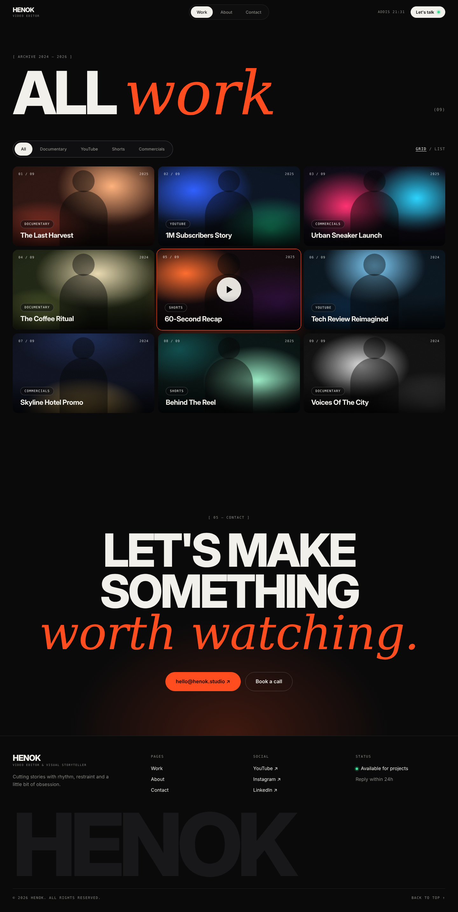
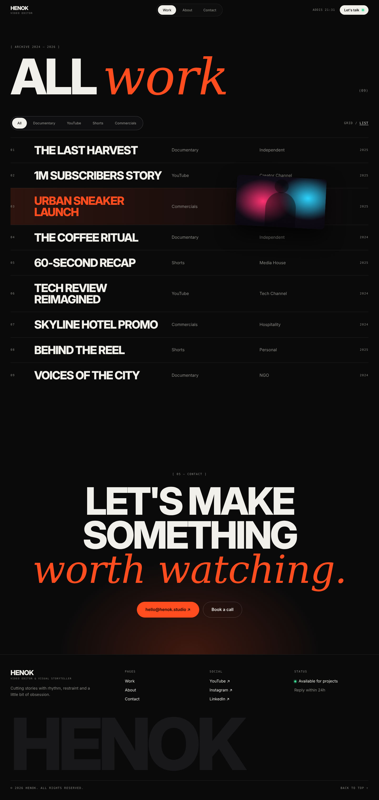

# Page spec · WORK  `/work`  (grid view + list view)

Files: `src/pages/Work.tsx`, `components/video/{VideoGrid,VideoList,FilterBar,ViewToggle,VideoCard}.tsx`.

## Mockups
| View | Grid | List |
|---|---|---|
| Desktop | `design/mockups/desktop/work-grid.png` | `design/mockups/desktop/work-list.png` |
| Annotated | `desktop-annotated/work-grid.png` | `desktop-annotated/work-list.png` |
| Mobile | `mobile/work-grid.png` | `mobile/work-list.png` |
| Source | `html/work-grid.html` | `html/work-list.html` |

Inspiration: ref-3 (title + pill filters) and ref-4 (dense grid, GRID/LIST toggle).

---

## Shared: [1] Header · [2] Title block
- `ptitle`: padding `170px 0 40px` (mobile `110px 0 24px`). Mono `[ Archive 2024 — 2026 ]` (mb 24px).
- **[3]** Row: `h1` **ALL *work*** — `display-page` size `clamp(64px, 13vw, 200px)`, line-height .85; "work" = serif accent at 1.02em. Count `(NN)` mono 13px bottom-aligned (pb 18px) = number of videos in the current filter. Mobile: row becomes a column, count under title.

## [4] Toolbar (grid view annotated as [4]; list view uses the same)
- `margin: 28px 0`. Flex, space-between, items center. Mobile: column, gap 14px.
- Left: **FilterBar** pill — All · Documentary · YouTube · Shorts · Commercials (design system "Filter pill bar"). Sliding highlight A10. On mobile the bar is `overflow-x:auto` with no wrapping and hidden scrollbar.
- Right: **ViewToggle** mono 12px, tracking .1em: `GRID / LIST`. Active word = `text` colour with 1px underline; inactive = `muted`. Persist choice in `localStorage` (try/catch) key `view`.
- Filter state lives in the URL: `?cat=Documentary` (omit for All). Changing filter keeps `?v=` out.

## GRID VIEW — [5] Grid
- `display:grid; grid-template-columns: repeat(3, 1fr); gap:12px` (mobile: 1 column, gap 12px). Tablet 701–1023px: 2 columns.
- Uses `VideoCard` (same visual as Home). Counter label `0N / NN` reflects position in filtered list. In the mockup card 05 is shown hovered (accent ring + play).
- Order: `display_order` ascending.
- Then `margin-bottom:140px`, then **CTA** (`pages/home.md` [14]) and **Footer**.

## LIST VIEW — [3] List + [4] Floating preview
- Container `position:relative`. Each row: grid `70px 1.6fr 1fr 1fr 80px`, gap 20px, padding 26px 0, border-top 1px `line`.
  - mono `01` · title `h3-list` uppercase · category (muted) · client (muted) · year mono right-aligned.
- Row hover: A11 (gradient bg, accent title). **Floating preview:** 340px wide 16:9 thumbnail, radius 12, rotate 3°, shadow `0 30px 70px rgba(0,0,0,.7)`, follows cursor; hidden on touch.
- **Mobile list:** each row = title (left) + year (right) only; hide number, category, client, floating preview. Tap opens modal.

## Clicking anything
- Card/row click → set `?v=<slug>` (keeps `cat`) → opens **Project modal** (`pages/project-modal.md`).

## States
- Loading: 6 skeleton cards. Empty (filter has none): centered `Nothing here yet — check back soon.` + ghost button "Show all work". Error: retry button.

## Acceptance checklist
- [ ] 3-col grid, 12px gaps, matches `work-grid.png`
- [ ] Filter pill highlight slides; counts update; URL updates
- [ ] List view matches `work-list.png`, floating preview follows cursor (desktop only)
- [ ] View choice persists after reload
- [ ] Mobile single column, filter bar horizontally scrollable, no overflow
